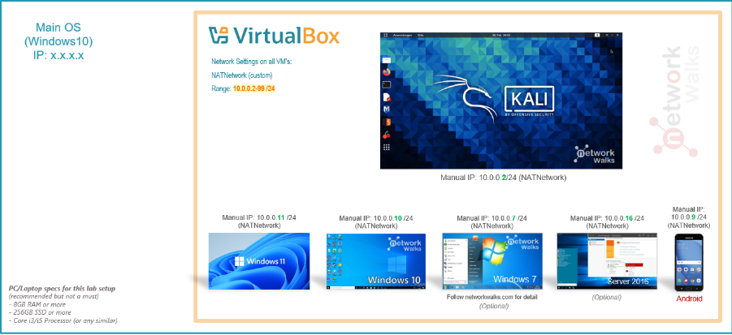

# 🔐 Cybersecurity Virtual Lab

### Building and configuring an isolated virtual environment for ethical hacking, penetration testing, and network security experimentation.

 

  

  

**Developed by Denzel**

---

## 📌 About This Project

This project involves the development of an isolated **Cybersecurity Testing Environment** using Oracle VirtualBox and Kali Linux.

The main objective is to establish a secure virtual lab for exploring cybersecurity concepts and gaining practical experience in ethical hacking. It provides a dedicated space to perform network reconnaissance, port scanning, vulnerability analysis, and penetration-testing exercises.

The environment operates on a private virtual network, allowing additional virtual machines to be integrated in the future. These machines can serve as testing targets for conducting controlled and authorized security assessments.

---
## 🎯 Project Goals

The main objectives of this project are to:

- Install and configure VirtualBox.
- Install/import Kali Linux as a virtual machine.
- Create a private **NAT Network** for the cybersecurity lab.
- Configure network connectivity for Kali Linux.
- Assign a consistent IP address to the Kali VM.
- Verify network connectivity and DNS resolution.
- Take a clean VM snapshot for recovery.
- Document the complete setup process.
- Prepare the environment for future cybersecurity projects.

---
## 🛡️ Purpose of the Lab

This virtual laboratory is designed to provide a safe, isolated space for developing practical cybersecurity skills and conducting authorized security assessments.

The environment supports hands-on learning and experimentation with various cybersecurity techniques, including:

- Network reconnaissance
- Port scanning
- Vulnerability assessment
- Packet analysis
- Web security testing
- Exploitation practice
- Security-tool experimentation

⚠️ **Important:** This laboratory must only be used for systems that you own or have explicit permission to test. Do not use the lab or its tools to attack unauthorized systems.
---
## 🏗️ Lab Architecture

Additional target machines can be added to the same virtual network in future projects.

## ⚙️ Virtual Lab Specifications

The following table outlines the hardware, software, and network settings used to build the virtual cybersecurity environment.

| Component                    | Configuration          |
| :--------------------------- | :--------------------- |
| 💻 Host Operating System     | Windows 10             |
| 🧠 Available RAM             | 8 GB                   |
| ⚡ Processor                  | Intel Core i5          |
| 📦 Virtualization Platform   | VirtualBox 7.2         |
| 🐉 Guest Operating System    | Kali Linux 2026.2      |
| 💾 Allocated VM Memory       | 2048 MB (2 GB)         |
| 🌐 Network Configuration     | NAT Network            |
| 📡 Private Network           | `10.0.0.0/24`          |
| 🖥️ Kali Linux IP            | `10.0.0.0/24`          |
| 🚪 Default Gateway           | `10.0.0.1`             |
| 🌍 DNS Configuration         | `10.0.0.1`             |
| 🔮 Reserved VM Address Range | `10.0.0.3 – 10.0.0.99` |

---

# 🪜 Virtual Lab Installation & Configuration

This section documents the installation and initial configuration steps required to establish the cybersecurity lab environment.

## Step 1 — Install 7-Zip

The 7-Zip utility was installed to handle the extraction of compressed Kali Linux virtual machine files, particularly packages distributed in `.7z` format.

**Utility:** 7-Zip
**Purpose:** Extracting compressed virtual machine archives.

---

## Step 2 — Set Up VirtualBox

Oracle VirtualBox was installed and configured to serve as the virtualization platform for hosting and managing the Kali Linux virtual machine.

**Platform:** Oracle VirtualBox 7.2

---

## Step 3 — Configure a Private NAT Network

A dedicated NAT Network was created through VirtualBox to establish a private networking environment for the cybersecurity lab.

### Network Settings

| Parameter           | Configuration |
| :------------------ | :------------ |
| Network Name        | `NatNetwork`  |
| IPv4 Network Prefix | `10.0.0.0/24` |
| DHCP Service        | Enabled       |
| IPv6 Support        | Disabled      |
| Network Mode        | NAT Network   |

**Purpose:** This configuration allows virtual machines connected to the network to communicate while providing external network connectivity through NAT.

---

