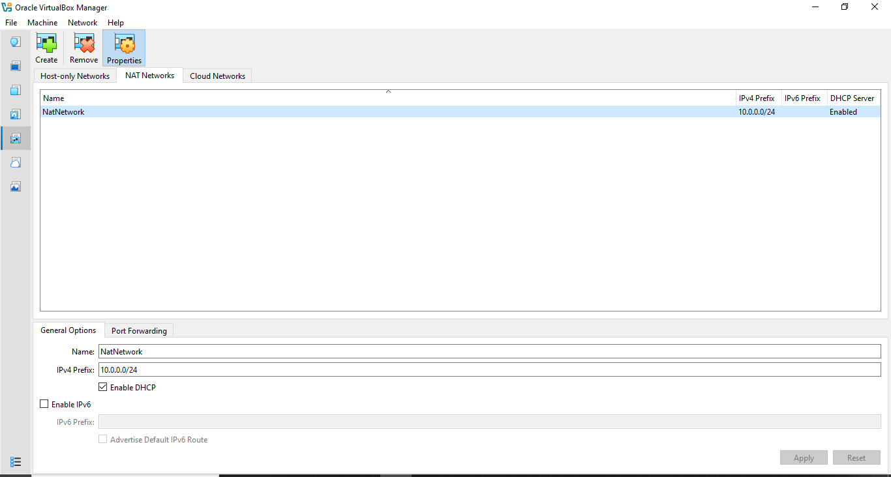
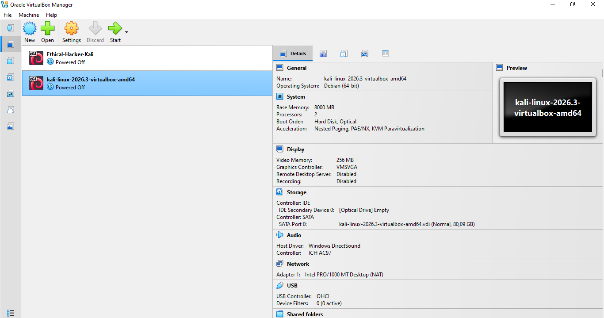
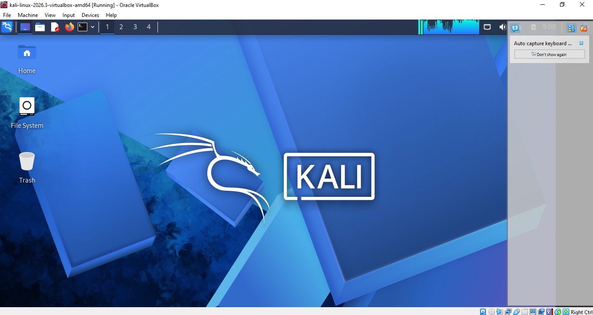
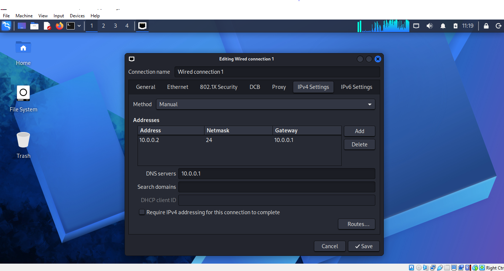

<div align="center">

# 🔐 Cybersecurity Virtual Lab

### Building and configuring an isolated virtual environment for ethical hacking, penetration testing, and network security experimentation.

<br>


<br><br>


<br><br>

**Developed by Denzel**

</div>

---

## 📌 About This Project

This project involves the development of an isolated **Cybersecurity Testing Environment** using Oracle VirtualBox and Kali Linux.

The main objective is to establish a secure virtual lab for exploring cybersecurity concepts and gaining practical experience in ethical hacking. It provides a dedicated space to perform network reconnaissance, port scanning, vulnerability analysis, and penetration-testing exercises.

The environment operates on a private virtual network, allowing additional virtual machines to be integrated in the future. These machines can serve as testing targets for conducting controlled and authorized security assessments.

---
## 🎯 Project Goals

The main objectives of this project are to:

- Install and configure VirtualBox.
- Install/import Kali Linux as a virtual machine.
- Create a private **NAT Network** for the cybersecurity lab.
- Configure network connectivity for Kali Linux.
- Assign a consistent IP address to the Kali VM.
- Verify network connectivity and DNS resolution.
- Take a clean VM snapshot for recovery.
- Document the complete setup process.
- Prepare the environment for future cybersecurity projects.

---
## 🛡️ Purpose of the Lab

This virtual laboratory is designed to provide a safe, isolated space for developing practical cybersecurity skills and conducting authorized security assessments.

The environment supports hands-on learning and experimentation with various cybersecurity techniques, including:

- Network reconnaissance
- Port scanning
- Vulnerability assessment
- Packet analysis
- Web security testing
- Exploitation practice
- Security-tool experimentation

⚠️ **Important:** This laboratory must only be used for systems that you own or have explicit permission to test. Do not use the lab or its tools to attack unauthorized systems.
---
## 🏗️ Lab Architecture


Additional target machines can be added to the same virtual network in future projects.

## ⚙️ Virtual Lab Specifications

The following table outlines the hardware, software, and network settings used to build the virtual cybersecurity environment.

| Component                    | Configuration          |
| :--------------------------- | :--------------------- |
| 💻 Host Operating System     | Windows 10             |
| 🧠 Available RAM             | 8 GB                   |
| ⚡ Processor                  | Intel Core i5          |
| 📦 Virtualization Platform   | VirtualBox 7.2         |
| 🐉 Guest Operating System    | Kali Linux 2026.2      |
| 💾 Allocated VM Memory       | 2048 MB (2 GB)         |
| 🌐 Network Configuration     | NAT Network            |
| 📡 Private Network           | `10.0.0.0/24`          |
| 🖥️ Kali Linux IP            | `10.0.0.0/24`          |
| 🚪 Default Gateway           | `10.0.0.1`             |
| 🌍 DNS Configuration         | `10.0.0.1`             |
| 🔮 Reserved VM Address Range | `10.0.0.3 – 10.0.0.99` |

---

# 🪜 Virtual Lab Installation & Configuration

This section documents the installation and initial configuration steps required to establish the cybersecurity lab environment.

## Step 1 — Install 7-Zip

The 7-Zip utility was installed to handle the extraction of compressed Kali Linux virtual machine files, particularly packages distributed in `.7z` format.

**Utility:** 7-Zip
**Purpose:** Extracting compressed virtual machine archives.

---

## Step 2 — Set Up VirtualBox

Oracle VirtualBox was installed and configured to serve as the virtualization platform for hosting and managing the Kali Linux virtual machine.

**Platform:** Oracle VirtualBox 7.2

---

## Step 3 — Configure a Private NAT Network

A dedicated NAT Network was created through VirtualBox to establish a private networking environment for the cybersecurity lab.

### Network Settings

| Parameter           | Configuration |
| :------------------ | :------------ |
| Network Name        | `NatNetwork`  |
| IPv4 Network Prefix | `10.0.0.0/24` |
| DHCP Service        | Enabled       |
| IPv6 Support        | Disabled      |
| Network Mode        | NAT Network   |

**Purpose:** This configuration allows virtual machines connected to the network to communicate while providing external network connectivity through NAT.

---


### Why NAT Network Was Chosen

The **NAT Network** option was selected because it allows multiple virtual machines connected to the same network to communicate with each other while maintaining outbound internet access.

This setup provides a suitable foundation for future cybersecurity exercises, where attacker and target virtual machines can interact within an isolated lab environment.

---

## Step 4 — Import and Configure Kali Linux

Kali Linux was obtained from the official Kali Linux website and imported into Oracle VirtualBox as the primary security-testing virtual machine.

After importing, the virtual machine's network adapter was configured to connect to the previously created NAT Network.

### Network Adapter Configuration

```text
Adapter:          Adapter 1
Connection Type:  NAT Network
Network Name:     NatNetwork
Adapter Type:     Intel PRO/1000 MT Desktop (NAT)
```

### Virtual Machine Resources

| Resource         | Allocation        |
| :--------------- | :---------------- |
| Operating System | Kali Linux 2026.2 |
| Allocated Memory | 2048 MB (2 GB)    |
| Network Adapter  | Adapter 1         |
| Network Mode     | NAT Network       |



**Configuration Goal:** Ensure Kali Linux is properly connected to the private lab network and ready for network testing and cybersecurity activities.



A shared folder was also configured for transferring required files between the host operating system and the Kali VM.

---
## Step 5. Configure the Kali Linux Network

The Kali Linux network configuration was checked and configured with a consistent IPv4 address.

Example configuration:

```text
IP Address: 10.0.0.2
Subnet Mask: 255.255.255.0
Gateway: 10.0.0.1
DNS: 8.8.8.8/ Use 10.0.0.1 if network gives you issues
```

A consistent IP address makes it easier to document the lab and reference the Kali machine in future exercises.



---

## Step 6. Create a Clean VM Snapshot

After completing the initial configuration, a VirtualBox snapshot was created.

Example snapshot name:

```text
Clean Kali - Network Setup
```

The snapshot represents the clean baseline of the laboratory.

If a future exercise changes or damages the VM configuration, the machine can be restored to this baseline.


---

# 🔎 Lab Verification

| ✅ Test                        | 🧾 Command                      | 🎯 Expected Result              |
| ----------------------------- | ------------------------------- | ------------------------------- |
| 🌐 Check IP address           | `ip a`                          | Correct Kali IP displayed       |
| 📡 Test gateway               | `ping 10.0.0.1`                 | Successful replies              |
| 🌍 Test Internet connectivity | `ping 8.8.8.8`                  | Successful replies              |
| 🔎 Test DNS resolution        | `nslookup networkwalks.com`     | Domain resolves                 |
| 🧰 Verify Nmap                | `nmap --version`                | Nmap version displayed          |
| 🔄 Verify snapshot            | Restore snapshot and run `ip a` | Baseline configuration restored |

### Example Results

```text
IP Address:
10.0.0.2/24

Gateway:
10.0.0.1

DNS:
8.8.8.8
```

---
# 🐞 Problems Encountered & Solutions

Documenting problems is an important part of the project.

## Problem 1. Internet Connectivity After Static IP Configuration

After manually configuring the IPv4 settings, Internet connectivity may fail depending on the Kali/NetworkManager configuration.

One workaround used during this lab was:

```bash
sudo nmcli connection modify "Wired connection 1" ipv4.dad-timeout 0
```

The network connection was then restarted/rebooted and connectivity was tested again.

> **Important:** Network interface and connection names may differ between systems. Students should first identify their actual connection name before running an `nmcli` command.

---

## Problem 2. VirtualBox VT-x / Virtualization Error

The VM initially failed to start because hardware virtualization was disabled in the system firmware/BIOS.

The issue was resolved by:

1. Restarting the computer.
2. Entering BIOS/UEFI settings.
3. Enabling Intel VT-x / hardware virtualization.
4. Saving the configuration.
5. Restarting the computer.
6. Starting the Kali VM again.

After enabling virtualization, the VM started successfully.


---

# 💡 What I Learned

Through this project, I learned how to create and configure a virtual environment for cybersecurity practice.

The most important concepts I learned include:

### 1. NAT vs NAT Network

A standard NAT configuration and a NAT Network serve different purposes.

A NAT Network allows multiple VMs connected to the same virtual network to communicate with one another while providing network address translation for external connectivity.

This makes it useful for building a multi-machine cybersecurity laboratory.

### 2. Virtual Machine Networking

I learned how VirtualBox virtual network adapters connect virtual machines to different types of networks and how network configuration affects communication between machines.

### 3. Static IP Configuration

I learned how to configure and verify IPv4 addressing, subnet masks, gateways, and DNS settings in Kali Linux.

### 4. VM Snapshots

I learned that a clean snapshot should be created **before performing risky or experimental activities**.

This provides a known-good recovery point for future cybersecurity exercises.

### 5. Documentation

I learned that documenting commands, configuration, screenshots, problems, and solutions is an important part of a professional cybersecurity project.

---

# 🔐 Security & Ethical Use

This laboratory is intended strictly for education purposes only.

---

# 🔗 Tools & Resources

- **7-Zip:** [https://7-zip.org/download.html](https://7-zip.org/download.html)
- **VirtualBox:** [https://virtualbox.org/wiki/Downloads](https://virtualbox.org/wiki/Downloads)
- **Kali Linux:** [https://kali.org/get-kali](https://kali.org/get-kali)

# 👤 Author

**Denzel.L.Zimidzi**\
Cybersecurity Professional B084

LinkedIn: [www.linkedin.com/in/denzel-zimidzi-26b957411](www.linkedin.com/in/denzel-zimidzi-26b957411)

---

## 📌 Project Information

**Program Name:** Cybersecurity at Networkwalks | **Week:** 01 | **Project:** Cybersecurity & Pentesting Lab Setup | **Repository:** GitHub


